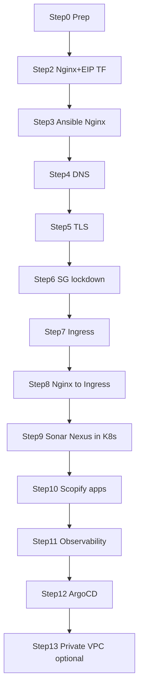

# Scopify Server — Implementation Plan

> **Goal:** Move from today’s flat public-IP lab to the frozen architecture in [`ARCHITECTURE.md`](./ARCHITECTURE.md).  
> **Repo:** `Scopify Server` (Terraform + Ansible + future K8s/Helm/Nginx).  
> **Rule:** Finish each **Step** and check its exit criteria before starting the next.  
> **Last updated:** 2026-07-13

---

## How to use this plan

| Column | Meaning |
|--------|---------|
| **Step** | Ordered work unit |
| **Where** | Files / AWS / UI to touch |
| **Exit criteria** | You are done with the step when… |

**Two tracks (pick one for networking):**

- **Track A — Hybrid (cheaper, recommended first):** keep instances in reachable subnets; lock them down with SGs; add Nginx + EIP. Defer NAT / true private subnets.  
- **Track B — Full private:** custom VPC public/private + NAT Gateway (~$32+/mo). Do after Track A works if you want production-like networking.

Most steps below work for **Track A**. Track B notes are called out where they differ.

---

## Current baseline (as-built)

Already in this repo / AWS:

| Piece | Status |
|-------|--------|
| Terraform: 6 EC2 (master, worker-1/2, jenkins, sonar, nexus) on **default VPC**, public IPs | Done |
| Ansible `site.yml` → kubeadm K8s | Done |
| Ansible `site-tools.yml` → Jenkins / Sonar / Nexus **on EC2** | Done |
| UI logins + password changes | Done (ops) |
| Nginx EC2, EIP, custom VPC, Ingress, in-cluster Sonar/Nexus, Scopify manifests | **Not started** |

---

## Roadmap overview

```
Step 0  Prep & inventory
Step 1  Rename / align project tags (optional but cleaner)
Step 2  Terraform: Nginx EC2 + EIP + nginx SG
Step 3  Ansible: install & configure Nginx reverse proxy
Step 4  Squarespace DNS → EIP
Step 5  TLS (Let’s Encrypt) on Nginx
Step 6  Security group lockdown (remove world-open tool ports)
Step 7  Kubernetes Ingress Controller
Step 8  Point Nginx app hostnames at Ingress
Step 9  Helm: Nexus + Sonar in-cluster (PVC); retire EC2 tools
Step10  Scopify API (then UI) manifests + first deploy
Step11  Observability (Prometheus / Grafana)
Step12  Argo CD (GitOps)
Step13  Track B (optional): real private subnets + NAT
Step14  Later: Route 53 + ALB (out of scope until above is solid)
```



---

## Step 0 — Prep and inventory

**Goal:** Know exact IPs, tags, and what not to break.

**Actions**
1. From `terraform/`: `terraform output` — save public/private IPs for all 6 nodes.  
2. Confirm SSH still works with your PEM.  
3. Confirm Jenkins / Sonar / Nexus UIs still load on current public IPs.  
4. Confirm K8s: on master, `kubectl get nodes`.  
5. Read [`ARCHITECTURE.md`](./ARCHITECTURE.md) once more — treat it as frozen.

**Where:** AWS console / Terraform outputs / SSH  

**Exit criteria**
- [ ] Written list of current private IPs (Jenkins, Sonar, Nexus, Master)  
- [ ] Cluster `Ready`  
- [ ] You accept Track A for the next steps (or explicitly choose Track B)

---

## Step 1 — Align naming — DONE in repo (apply in AWS next)

**Goal:** Use `scopify-cluster` / `scopify-*-sg` everywhere.

**Done in git**
- `terraform.tfvars` + `.example`: `project_name = "scopify-cluster"`, SG names `scopify-*-sg`
- `ansible/inventories/aws_ec2.yml`: `tag:Project: scopify-cluster`
- Docs/paths updated to Scopify Server

**You must still run**
```bash
cd terraform
terraform plan   # expect tag updates; SG *name* changes may force SG replace
terraform apply
```
Then verify: `ansible-inventory --graph` still lists all hosts.

**Exit criteria**
- [ ] `terraform apply` completed
- [ ] EC2 tag `Project=scopify-cluster`
- [ ] Ansible inventory non-empty for master/workers/jenkins/sonar/nexus

---

## Step 2 — Terraform: Nginx edge + Elastic IP

**Goal:** Only new public entry point in code.

**Actions**
1. Add security group `nginx` in tfvars:
   - Inbound: 80, 443 from `0.0.0.0/0`
   - SSH from your IP only (preferred)
2. Add instance `nginx` (public subnet, public IP or EIP primary).  
3. Add `aws_eip` + `aws_eip_association` for Nginx (new Terraform resources — extend `main.tf` / new module as needed).  
4. Outputs: `nginx_public_ip`, `nginx_eip`, `nginx_private_ip`, SSH command.  
5. `terraform plan` → `apply`.

**Where:** `terraform/variables.tf`, `terraform.tfvars`, `main.tf`, `outputs.tf`, maybe `modules/ec2`  

**Exit criteria**
- [ ] Nginx EC2 running  
- [ ] Elastic IP attached and stable after stop/start of Nginx  
- [ ] You can SSH to Nginx  

**Note:** Do **not** remove Sonar/Nexus EC2s yet.

---

## Step 3 — Ansible: Nginx reverse proxy (HTTP first)

**Goal:** Host-based proxy to **current** EC2 backends (still on VMs).

**Actions**
1. New role `ansible/roles/nginx/` (install nginx, deploy vhost templates).  
2. New playbook `ansible/site-nginx.yml` (hosts: nginx).  
3. Inventory: add group `nginx` for `ec2_tags.Role == 'nginx'`.  
4. group_vars: backend private IPs (or discover via hostvars) for:
   - `jenkins.ashmit.xyz` → Jenkins:8080  
   - `sonar.ashmit.xyz` → Sonar:9000  
   - `nexus.ashmit.xyz` → Nexus:8081  
5. Temporarily test with `/etc/hosts` pointing those names at the **EIP** before DNS.  
6. Curl via Host header:
   ```bash
   curl -H "Host: jenkins.ashmit.xyz" http://<EIP>/
   ```

**Where:** `ansible/roles/nginx/`, `site-nginx.yml`, `inventories/aws_ec2.yml`, `group_vars/nginx.yml`  

**Exit criteria**
- [ ] HTTP proxy works for jenkins/sonar/nexus via Host header → EIP  
- [ ] Playbook is idempotent (`ansible-playbook site-nginx.yml` twice is safe)

---

## Step 4 — Squarespace DNS

**Goal:** Real DNS to the single EIP.

**Actions**
1. Create A records (all → Nginx EIP):
   - `jenkins`
   - `sonar`
   - `nexus`
   - (optional placeholders) `api`, `app`, `grafana`, `prometheus`, `argocd`  
2. Wait for propagation; `dig jenkins.ashmit.xyz`.

**Where:** Squarespace DNS UI (not in this repo)  

**Exit criteria**
- [ ] All required names resolve to the EIP  
- [ ] Browser hits `http://jenkins.ashmit.xyz` via Nginx (HTTP OK for now)

---

## Step 5 — TLS (Let’s Encrypt)

**Goal:** HTTPS on the edge.

**Actions**
1. On Nginx: Certbot (nginx plugin) for the hostnames you created.  
2. Force HTTP → HTTPS redirects in Nginx config (Ansible-managed).  
3. Renew cron/systemd timer verified.

**Where:** `ansible/roles/nginx/` templates + Certbot tasks  

**Exit criteria**
- [ ] `https://jenkins.ashmit.xyz` (and sonar/nexus) work with valid cert  
- [ ] Auto-renew path documented in role README or comments  

---

## Step 6 — Security group lockdown

**Goal:** Internet can reach **only** Nginx 80/443 (and admin SSH/SSM).

**Actions**
1. Jenkins SG: remove `0.0.0.0/0` on 8080; allow **Nginx SG** → 8080 (and your IP if debugging).  
2. Sonar SG: only Nginx SG → 9000.  
3. Nexus SG: only Nginx SG → 8081.  
4. Cluster SG: tighten 6443 to Jenkins SG + admin IP; NodePorts only from Nginx SG (as needed).  
5. `terraform apply`.  
6. Verify: public IP:8080 of Jenkins **fails** from laptop; `https://jenkins.ashmit.xyz` **works**.

**Where:** `terraform/terraform.tfvars` (and SG module if source SG references needed — may require `security_groups` module to support SG-to-SG rules, not only CIDRs)

**Exit criteria**
- [ ] Direct public access to tool ports blocked  
- [ ] Access via `*.ashmit.xyz` still works  

**Important:** If SG module only supports `cidr_blocks` today, extend it for `source_security_group_id` before this step.

---

## Step 7 — Kubernetes Ingress Controller

**Goal:** In-cluster HTTP entry for future pods.

**Actions**
1. Install NGINX Ingress Controller (Helm or manifests) on the existing kubeadm cluster.  
2. Expose Ingress via NodePort (or hostNetwork lab mode) on workers/master.  
3. Note the NodePort or internal endpoint Nginx will use.  
4. Add folder e.g. `k8s/ingress/` or `helm/` under Scopify Server with install notes.

**Where:** new `k8s/` (or `helm/`) in this repo; run from master / Jenkins later  

**Exit criteria**
- [ ] `kubectl get pods -n ingress-nginx` healthy  
- [ ] Test Ingress with a sample `ingress-nginx` echo / httpbin app  

---

## Step 8 — Nginx routes app hostnames to Ingress

**Goal:** Split traffic: Jenkins → EC2; everything else → Ingress.

**Actions**
1. Update Nginx upstreams:
   - `jenkins.*` → Jenkins private IP  
   - `sonar|nexus|api|app|grafana|…` → Ingress NodePort / private LB address  
2. Redeploy via `site-nginx.yml`.  
3. Keep Sonar/Nexus EC2 routes until Step 9 cutover.

**Where:** `ansible/roles/nginx/`  

**Exit criteria**
- [ ] Sample in-cluster app reachable via `https://<test>.ashmit.xyz`  
- [ ] Jenkins still via its hostname  

---

## Step 9 — Move Sonar + Nexus into Kubernetes; retire EC2s

**Goal:** Match frozen arch (tools as pods + PVC).

**Actions**
1. Helm install Nexus with PVC; create Docker hosted repo; set public URL `https://nexus.ashmit.xyz`.  
2. Helm install SonarQube with PVC (or Postgres dependency).  
3. Ingress resources for both hostnames.  
4. Migrate any needed config/tokens; update Jenkins credentials to new URLs.  
5. Switch Nginx from EC2 backends → Ingress for sonar/nexus.  
6. Terraform: remove `sonar` and `nexus` instances + SGs from tfvars; `apply` (destroy those EC2s).  
7. Ansible: stop using sonar/nexus plays in day-2 ops (`site-tools.yml` → Jenkins-only or split playbooks).

**Where:** `k8s/` or `helm/`, Terraform tfvars, `ansible/site-tools.yml`  

**Exit criteria**
- [ ] Sonar + Nexus only in cluster  
- [ ] PVCs bound and survive pod restart  
- [ ] EC2 Sonar/Nexus gone  
- [ ] Jenkins still healthy on its EC2  

---

## Step 10 — Scopify API (then UI) on Kubernetes

**Goal:** Product workloads on the cluster.

**Actions**
1. Add manifests/Helm under e.g. `k8s/scopify/`: Deployment, Service, Ingress (`api.ashmit.xyz`), Secrets/ConfigMaps.  
2. Postgres + Redis (in-cluster Helm or external — decide and document).  
3. Image from GHCR or in-cluster Nexus.  
4. Wire Jenkins (in scopify-backend repo) to build/push/deploy **or** wait for Argo (Step 12).  
5. Later: Scopify UI at `app.ashmit.xyz`.

**Where:** `k8s/scopify/`; backend repo Jenkinsfile / GHCR  

**Exit criteria**
- [ ] `https://api.ashmit.xyz/health` works  
- [ ] Secrets not committed to git  

---

## Step 11 — Observability (Prometheus + Grafana)

**Goal:** Cluster metrics + dashboards behind Nginx.

**Actions**
1. Install `kube-prometheus-stack` (Helm).  
2. Ingress for `grafana.ashmit.xyz` (Prometheus often internal-only).  
3. Nginx already routes those hosts to Ingress (Step 8).  
4. Basic dashboards for nodes + scopify namespace.

**Where:** `helm/observability/` or documented Helm values in `k8s/`  

**Exit criteria**
- [ ] Grafana login via `https://grafana.ashmit.xyz`  
- [ ] Metrics visible for cluster  

---

## Step 12 — Argo CD (GitOps)

**Goal:** Jenkins builds images; Argo syncs cluster state from Git.

**Actions**
1. Install Argo CD; Ingress `argocd.ashmit.xyz`.  
2. Point Application(s) at this repo’s `k8s/` (or a `deploy/` repo).  
3. Change Jenkins deploy stage to “update image tag in Git” instead of raw kubectl (optional gradual).  

**Where:** `k8s/argocd/`, GitHub  

**Exit criteria**
- [ ] Argo UI reachable  
- [ ] At least one app auto-syncs from Git  

---

## Step 13 — Track B (optional): true private subnets + NAT

**Goal:** Full networking realism from ARCHITECTURE.md.

**Actions**
1. New Terraform VPC module: public subnet (Nginx + NAT EIP), private subnets (Jenkins + K8s).  
2. NAT Gateway for private outbound.  
3. Migrate / recreate instances into private subnets (expect downtime / rebuild).  
4. Bastion or SSM Session Manager for admin access (no SSH from world).  
5. Update Ansible inventory (still tag-based).  

**Exit criteria**
- [ ] Only Nginx has public EIP  
- [ ] Private nodes have no public IP  
- [ ] Outbound pulls still work via NAT  

**Skip while learning** if monthly NAT cost is not worth it.

---

## Step 14 — Later (explicitly not now)

- Route 53 migration  
- AWS ALB + AWS Load Balancer Controller  
- Multi-AZ HA for Nginx  

Document only; do not start until Steps 0–12 are stable.

---

## Suggested repo layout (end state)

```
Scopify Server/
├── ARCHITECTURE.md          # frozen design
├── IMPLEMENTATION_PLAN.md   # this file
├── terraform/               # VPC (later), EC2, SG, EIP
├── ansible/
│   ├── site.yml             # K8s nodes
│   ├── site-tools.yml       # Jenkins only (eventually)
│   ├── site-nginx.yml       # edge proxy
│   └── roles/…              # + nginx role
└── k8s/                     # NEW
    ├── ingress/
    ├── sonar/
    ├── nexus/
    ├── scopify/
    ├── observability/
    └── argocd/
```

---

## Immediate next action (start here)

**Do Step 0 today**, then **Step 2** (Nginx + EIP in Terraform).  
Do not start in-cluster Sonar/Nexus or Scopify deploy until Nginx + DNS + SG lockdown (Steps 2–6) work.

When Step 2 is ready to code, say so and we implement Terraform changes in this repo step by step.
