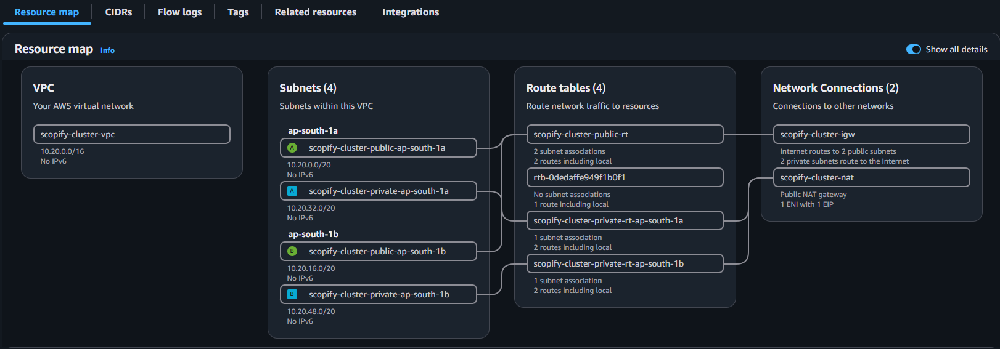

# Scopify Infrastructure — Engineering Documentation

| Field | Value |
|-------|-------|
| **Status** | Production-oriented personal / lab platform (as-built + frozen target) |
| **Region** | `ap-south-1` (Mumbai) |
| **Domain** | `ashmit.xyz` |
| **Project tag** | `scopify-cluster` |
| **Owner** | Ashmit |
| **Last reviewed** | 2026-07-30 |
| **Source of truth (design)** | `Scopify Server/ARCHITECTURE.md` |
| **Source of truth (as-built)** | `terraform/terraform.tfvars` + Ansible + `k8s/` |

> This is internal-style engineering documentation for the Scopify AWS platform.  
> It records **what exists in code**, **why decisions were made**, and **what is still incomplete**.  
> Where live console evidence is missing, placeholders are marked `TODO` — nothing is invented.

---

## 1. Executive Summary

Scopify infrastructure is a **custom-VPC AWS lab** that hosts CI/CD tooling and a **kubeadm Kubernetes cluster** used to run the Scopify NestJS API. Public traffic enters through **one Elastic IP** attached to an Nginx edge EC2 (behind Cloudflare DNS/TLS), while Jenkins, SonarQube, Nexus, and all Kubernetes nodes live in **private subnets** with outbound access via a **NAT Gateway** and admin access via **AWS Systems Manager Session Manager** (no bastion).

Application delivery is **GitOps**: Jenkins builds container images, pushes to **GHCR**, bumps image digests/tags in the Scopify-Server Kubernetes manifests, and **Argo CD** reconciles the cluster. Environments are split into `scopify-dev` and `scopify-prod` namespaces with mirrored Kustomize trees.

This stack deliberately trades managed-service convenience (EKS, ALB, ECR) for **learning surface area and cost control**, while still modeling production patterns: network isolation, least-privilege IAM for SSM/EBS CSI, immutable image tags, PreSync DB migrations, and a single public attack surface.

---

## 2. Project Goals

1. Host the **Scopify backend** (NestJS + Prisma + Postgres + Redis) on Kubernetes with realistic deploy paths.
2. Operate a **single public edge** (Nginx + Cloudflare) for all human-facing HTTPS hostnames.
3. Keep CI (**Jenkins**) and cluster nodes **off the public internet**.
4. Practice **Terraform → Ansible → Kubernetes → GitOps** as a full platform lifecycle.
5. Document decisions so the system remains understandable after AWS resources are destroyed.

---

## 3. Problems This Infrastructure Solves

| Problem | Solution in this stack |
|---------|------------------------|
| Multiple public IPs / open tool ports | One Nginx EIP; tools listen only inside VPC |
| SSH bastion sprawl | SSM Session Manager + IAM instance profile |
| “Deploy by SSH and kubectl by hand” | Jenkins image build + Git commit → Argo CD sync |
| Config drift between envs | Mirrored `dev/` and `prod/` Kustomize trees |
| DB schema ahead of app rollouts | Argo CD `PreSync` Prisma migrate Job |
| Untracked AWS changes | Terraform modules for VPC, SG, EC2, EIP, IAM, endpoints |
| Wildcard TLS without exposing HTTP-01 | Let’s Encrypt DNS-01 via Cloudflare API |

---

## 4. High Level Architecture

```
Internet
   │
   ▼
Cloudflare (DNS; optional proxy/WAF)
   │
   ▼
Elastic IP ──► Nginx EC2 (public subnet) ── TLS termination / Host routing
                      │
        ┌─────────────┼──────────────────────────┐
        ▼             ▼                          ▼
   Jenkins:8080   Sonar:9000 / Nexus:8081   Ingress-Nginx NodePort
   (private EC2)  (private EC2s)            (private K8s workers)
                                                     │
                                                     ▼
                                          Scopify API / Argo CD / …
```

See: [Overall Architecture](./architecture/overall.md) · [diagrams](./diagrams/README.md)



This live AWS resource map is the closest current as-built overview available from the imported screenshots. It confirms the custom VPC, 2 public subnets, 2 private subnets, route tables, IGW, and NAT topology described in this documentation.

---

## 5. Technology Stack

| Layer | Choice | Evidence |
|-------|--------|----------|
| Cloud | AWS `ap-south-1` | `terraform.tfvars` |
| IaC | Terraform ≥ 1.5, AWS provider ~> 6.0 | `providers.tf` |
| Config mgmt | Ansible (dynamic EC2 inventory) | `ansible/` |
| Edge | Nginx `1.27-alpine` in Docker + Certbot DNS-01 | `roles/nginx` |
| DNS / TLS edge | Cloudflare + Let’s Encrypt wildcard | `group_vars/nginx.yml` |
| CI | Jenkins on private EC2 (Docker) | `site-tools.yml`, Jenkinsfile |
| Registry | GHCR `ghcr.io/ashmit-gupta/scopify-backend` | Jenkinsfile |
| GitOps | Argo CD | Ingress + PreSync hooks in manifests |
| Orchestration | kubeadm Kubernetes **1.35.6** | `group_vars/all.yml` |
| CNI | Calico **v3.29.4** | `group_vars/all.yml` |
| Ingress | ingress-nginx **controller-v1.15.1** (baremetal/NodePort) | Ansible + Ingress resources |
| Storage | aws-ebs-csi-driver + StorageClass `gp3` | `k8s/platform/storage/` |
| App | NestJS 11, Prisma, Postgres 15, Redis 7 | Backend repo + K8s manifests |
| Scanning | Trivy (report-only in pipeline today) | Jenkinsfile |
| SAST | SonarQube (pipeline stages currently disabled) | Jenkinsfile `when { false }` |

---

## 6. Complete Infrastructure Overview

### Compute (Terraform `instances` map)

| Key | Tier | Type (tfvars) | Role |
|-----|------|---------------|------|
| `nginx` | public | `t3.small` | Edge reverse proxy + TLS |
| `master` | private | `c7i-flex.large` | kubeadm control plane |
| `worker-1` | private | `c7i-flex.large` | Kubernetes worker |
| `worker-2` | private | `c7i-flex.large` | Kubernetes worker |
| `jenkins` | private | `c7i-flex.large` | CI (Docker Jenkins) |
| `sonar` | private | `c7i-flex.large` | SonarQube (temporary EC2) |
| `nexus` | private | `c7i-flex.large` | Nexus (temporary EC2) |

### Network

- VPC CIDR: `10.20.0.0/16`
- 2 AZs, public + private `/20` subnets via `cidrsubnet`
- IGW + NAT Gateway + Nginx EIP + NAT EIP
- SSM interface endpoints enabled (`ssm`, `ssmmessages`, `ec2messages`)

### Kubernetes workloads (in Git)

| Namespace | Workloads |
|-----------|-----------|
| `scopify-prod` | Postgres STS, Redis, API Deployment, migrate Job, Ingress `aws-api.ashmit.xyz` |
| `scopify-dev` | Same pattern; Ingress `dev-aws-api.ashmit.xyz` |
| `argocd` | Argo CD server (install path); Ingress `argocd.ashmit.xyz` |
| `ingress-nginx` | Ingress controller (Ansible baremetal manifest) |
| `monitoring` | **Planned** — kube-prometheus-stack Application is commented out |

---

## 7. Network Topology

Documented in [networking/](./networking/README.md).

Summary: public subnet holds Nginx + NAT; private subnets hold all other EC2s; private default route → NAT; public default route → IGW; security groups segment nginx / cluster / jenkins / sonar / nexus.

---

## 8. Deployment Flow

```
Developer → GitHub (scopify-backend)
         → Jenkins (checkout, build, Trivy, push GHCR)
         → sed image tag in Scopify-Server k8s manifests
         → git push Scopify-Server
         → Argo CD sync
         → PreSync migrate Job → API rollout
         → Pods Running
```

Details: [deployment/](./deployment/README.md) · [architecture/deployment-flow.md](./architecture/deployment-flow.md)

---

## 9. Security Overview

- Single public SG on Nginx (`22/80/443` — lab-open; tighten planned)
- Private SG rules scoped to VPC CIDR `10.20.0.0/16` for tools and cluster
- SSM IAM (`AmazonSSMManagedInstanceCore`) + optional `AmazonEBSCSIDriverPolicy`
- No bastion host by design
- Secrets for K8s apps are **gitignored**; examples committed
- TLS 1.2/1.3 on edge Nginx; wildcard cert via DNS-01
- Image vulnerability scan via Trivy (non-blocking today)

Details: [security/](./security/README.md)

---

## 10. CI/CD Overview

Jenkins Pipeline-from-SCM on `scopify-backend`:

`Checkout → Check Docker → (Sonar disabled) → Build → Trivy → GHCR login/push → Update manifests → Push Git`

Branch mapping: `dev` → `scopify-dev`; `main` → `scopify-prod`.

Details: [jenkins/](./jenkins/README.md)

---

## 11. GitOps Overview

Argo CD watches `Scopify-Server` paths `k8s/scopify-backend/{dev,prod}` (Kustomize). Jenkins never `kubectl apply`s the app in the happy path — it only mutates Git.

Details: [argocd/](./argocd/README.md)

---

## 12. Monitoring Overview

kube-prometheus-stack is **designed** (commented Argo Application with Grafana Ingress `grafana.ashmit.xyz`, Prometheus PVC, Alertmanager). **Not enabled in Git as an active Application.**

Details: [monitoring/](./monitoring/README.md)

---

## 13. Disaster Recovery Strategy

| Asset | Current posture | Gap |
|-------|-----------------|-----|
| Terraform state | Local (`terraform.tfstate` in repo workspace) | No S3 + DynamoDB locking |
| EC2 / VPC | Recreatable from Terraform + Ansible | Documented rebuild window required |
| Postgres / Redis data | gp3 PVCs via EBS CSI | No automated snapshots / AWS Backup in Terraform |
| Container images | GHCR tags (git SHA short) | Retention policy TODO |
| Secrets | Manual kubectl apply of gitignored YAML | No ExternalSecrets / SealedSecrets yet |

Details: [architecture/disaster-recovery.md](./architecture/disaster-recovery.md)

---

## 14. Scaling Strategy

| Layer | Today | Scale path |
|-------|-------|------------|
| API replicas | `1` | Increase Deployment replicas / HPA (not configured) |
| Workers | 2× `c7i-flex.large` | Add worker instances in Terraform + `kubeadm join` |
| NAT | Single NAT Gateway | Multi-NAT per AZ (cost ↑, HA ↑) |
| Edge Nginx | Single EC2 SPOF | Active/passive or move to ALB (Phase 3) |
| Postgres | Single StatefulSet | Managed RDS / primary-replica (future) |

---

## 15. Cost Optimization Decisions

- One public EIP (Nginx) instead of EIP-per-host
- `t3.small` for Nginx; larger flex instances only where needed
- Interface VPC endpoints limited to SSM trio (not full ECR/logs set)
- Sonar/Nexus still on EC2 (temporary) — target is in-cluster PVC to retire two VMs
- Destroy / stop lab when idle (operational discipline)

Details: [cost/](./cost/README.md)

---

## 16. Future Improvements

1. Enable kube-prometheus-stack Application; wire Alertmanager
2. Move SonarQube + Nexus into Kubernetes; delete EC2s
3. Remote Terraform state (S3 + lock table)
4. Tighten Nginx SSH to admin CIDR or remove SSH entirely
5. NetworkPolicies + SG sources from Nginx SG only (not full VPC CIDR)
6. Blocking Trivy / re-enable Sonar Quality Gate
7. SealedSecrets or External Secrets Operator
8. Phase 3: Route 53 + ALB + AWS LB Controller (optional)
9. Multi-AZ NAT / control-plane HA if this leaves “lab” status

---

## 17. Repository Structure

```
scopify/
├── docs/                      ← this documentation set
├── Scopify Server/            ← platform: Terraform, Ansible, k8s, Nginx
│   ├── terraform/
│   ├── ansible/
│   ├── k8s/
│   ├── ARCHITECTURE.md
│   └── IMPLEMENTATION_PLAN.md
└── Scopify Backend/           ← NestJS API, Dockerfile, Jenkinsfile
    ├── backend/
    └── Jenkinsfile
```

Related external repos (GitHub):

| Repo | Role |
|------|------|
| [Scopify-Server](https://github.com/Ashmit-Gupta/Scopify-Server) | Infra + GitOps manifests |
| [scopify-backend](https://github.com/Ashmit-Gupta/scopify-backend) | Application + CI Jenkinsfile |

---

## 18. Documentation Index

### Architecture
- [Overall Architecture](./architecture/overall.md)
- [Networking](./architecture/networking.md)
- [Traffic Flow](./architecture/traffic-flow.md)
- [Deployment Flow](./architecture/deployment-flow.md)
- [Authentication Flow](./architecture/authentication-flow.md)
- [CI/CD Flow](./architecture/cicd-flow.md)
- [GitOps Flow](./architecture/gitops-flow.md)
- [Observability Flow](./architecture/observability-flow.md)
- [Security Flow](./architecture/security-flow.md)
- [Disaster Recovery](./architecture/disaster-recovery.md)

### Domains
- [Networking](./networking/README.md)
- [Terraform](./terraform/README.md)
- [Ansible](./ansible/README.md)
- [Kubernetes](./kubernetes/README.md)
- [Jenkins](./jenkins/README.md)
- [Argo CD](./argocd/README.md)
- [Monitoring](./monitoring/README.md)
- [Security](./security/README.md)
- [Deployment](./deployment/README.md)
- [Troubleshooting](./troubleshooting/README.md)
- [Cost](./cost/README.md)
- [Diagrams](./diagrams/README.md)
- [Screenshot checklist](./SCREENSHOTS.md)

### Architecture Decision Records
- [ADR index](./decisions/README.md)
- [ADR-001: kubeadm instead of EKS](./decisions/ADR-001-kubeadm-vs-eks.md)
- [ADR-002: SSM instead of bastion](./decisions/ADR-002-ssm-vs-bastion.md)
- [ADR-003: VPC endpoints](./decisions/ADR-003-vpc-endpoints.md)
- [ADR-004: Nginx edge](./decisions/ADR-004-nginx-edge.md)
- [ADR-005: Argo CD](./decisions/ADR-005-argocd.md)
- [ADR-006: GHCR](./decisions/ADR-006-ghcr.md)
- [ADR-007: Kustomize](./decisions/ADR-007-kustomize.md)
- [ADR-008: Terraform](./decisions/ADR-008-terraform.md)
- [ADR-009: Jenkins on EC2](./decisions/ADR-009-jenkins-on-ec2.md)
- [ADR-010: Calico CNI](./decisions/ADR-010-calico.md)

---

## Document conventions

- **As-built** = present in `terraform.tfvars`, Ansible, or applied manifests.
- **Frozen target** = `ARCHITECTURE.md` intent (may still be migrating).
- **TODO** = missing evidence; do not treat as deployed fact.
- Screenshots use the `[ Screenshot Required ]` block until replaced.
