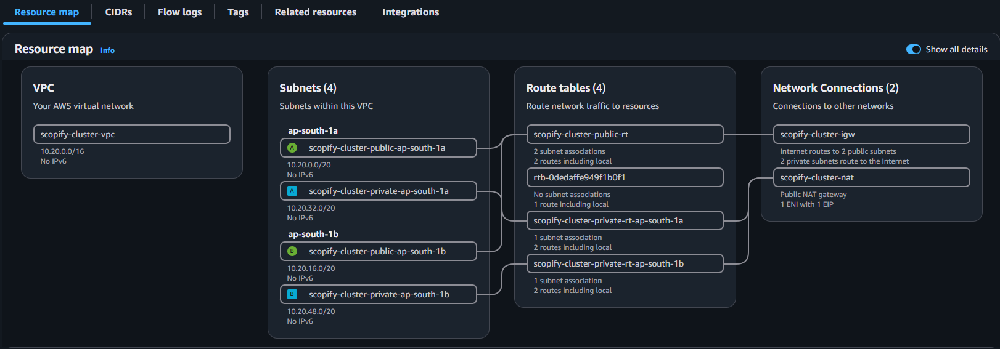
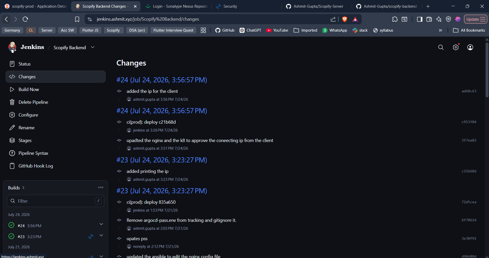
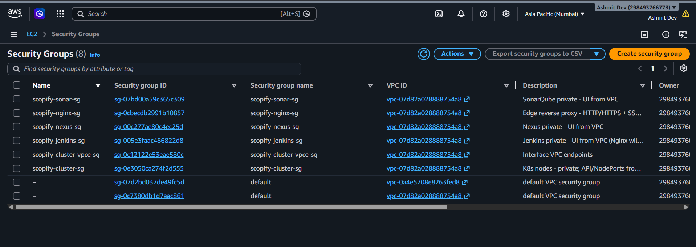
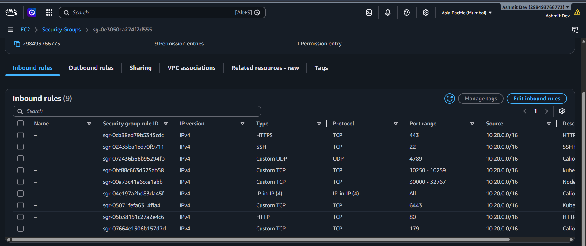

# Diagrams

Architecture visuals for Scopify infrastructure. Prefer linking existing draw.io sources over inventing new topology.

## Existing sources (in Server repo)

| Asset | Path |
|-------|------|
| Multi-page architecture | `Scopify Server/docs/Scopify-Server-Architecture.drawio` |
| Frozen ASCII target | `Scopify Server/ARCHITECTURE.md` |
| Dependency flow | `Scopify Server/terraform/DEPENDENCY_FLOW.md` |

Export PNGs into this folder when ready:

```
docs/diagrams/
  overall.png
  networking.png
  traffic-flow.png
  cicd-gitops.png
  security-boundaries.png
```

## Imported screenshot set

Screenshots imported from the referenced private Notion export have been downloaded to `docs/diagrams/assets/`.

- Asset index: `docs/diagrams/assets/index.csv`
- Clean catalog: `docs/diagrams/IMAGE_CATALOG.md`
- Verified images already wired into docs:
  - `01-1-vpc-ss.png`
  - `04-resource-map.png`
  - `05-subnets.png`
  - `06-route-table.png`
  - `12-nat.png`
  - `14-eip.png`
  - `16-vpc-endpoints.png`
  - `20-ssm-system-session-manager.png`
  - `23-sgs.png`
  - `28-sgs-for-cluster.png`
  - `31-iam.png`
  - `34-cloudflare-dns.png`
  - `49-jenkins.png`

Some imported assets have weak labels in the source export and remain in `assets/` for manual review before embedding.

## Placeholder catalog

### Overall

[ Screenshot Required ]

**Description:** Exported draw.io page — overall  
**Purpose:** README hero diagram  
**Evidence:** Confirms edge + private + K8s  
**TODO:** Waiting for screenshot

### Networking



### Traffic flow

[ Screenshot Required ]

**Description:** Request path annotated  
**TODO:** Waiting for screenshot

### CI/CD + GitOps



### Security boundaries





### Terraform graph

[ Screenshot Required ]

**Description:** `terraform graph` rendering  
**TODO:** Waiting for screenshot
