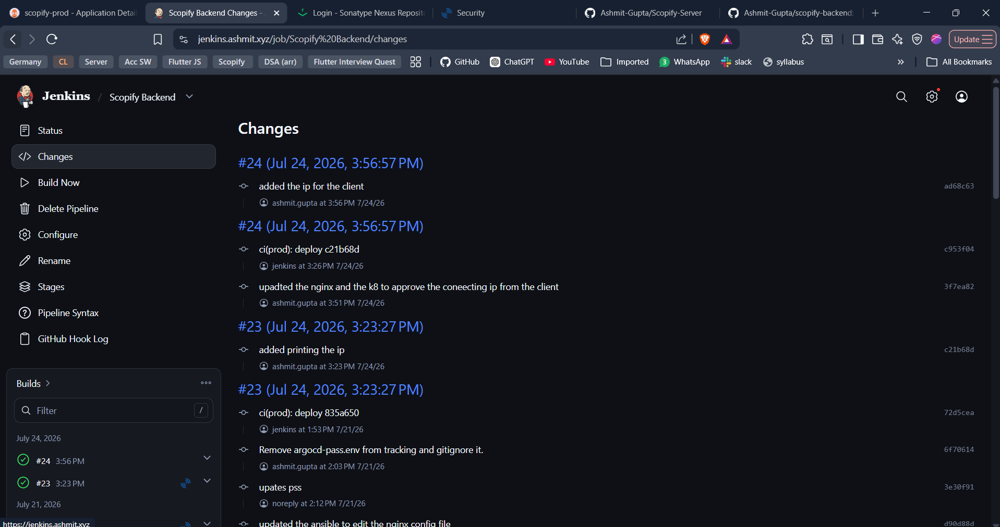

# Jenkins

CI control plane for Scopify backend images and GitOps manifest bumps.

---

## Architecture

| Item | Value |
|------|-------|
| Host | Private EC2 `jenkins` |
| Runtime | Jenkins in Docker (Ansible `roles/jenkins`) |
| Public URL | `https://jenkins.ashmit.xyz` → Nginx → `:8080` |
| Agent model | `agent any` on controller (Docker socket mounted) |
| Extra tools | Trivy, kubectl (pinned), kubeconfig at `/opt/scopify-kube/config` mounted into container |
| Disk | 30 GB root in tfvars |

**Why dedicated EC2:** Frozen architecture — CI stays outside the app cluster to isolate build load and simplify Docker-in-Docker/socket patterns.

```
Developer push
    → GitHub webhook / poll
    → Jenkins controller (private)
    → docker build/push
    → git push Scopify-Server
```

---

## Pipeline

- **Job type:** Pipeline script from SCM  
- **Repo:** `https://github.com/Ashmit-Gupta/scopify-backend.git`  
- **Script:** `Jenkinsfile`  
- **Branches:** `main`, `dev` only  

---

## Stages

| Stage | Behavior |
|-------|----------|
| Checkout | SCM + clone Scopify-Server; set env/ns; compute `IMAGE_TAG` short SHA |
| Check Docker | Verify CLI + daemon |
| SonarQube Analysis | **Disabled** (`when { expression { false } }`) |
| Quality Gate | **Disabled** |
| Build Docker Image | `backend/Dockerfile`, tag SHA + `latest` |
| Trivy Scan | FS + image; `--exit-code 0` (report only) |
| Login to GHCR | `github-token` |
| Push Image | SHA + latest |
| Update K8s manifests | `sed` on `api-deployment.yml` + `migrate-job.yml` |
| Push manifests to Git | Commit `ci(<env>): deploy <tag>` |

Environment mapping:

| Branch | `K8S_ENV` | Namespace |
|--------|-----------|-----------|
| `main` | `prod` | `scopify-prod` |
| `dev` | `dev` | `scopify-dev` |

---

## Credentials

| ID | Use |
|----|-----|
| `github-token` | Username/password — GHCR login + Git clone/push Server |

Sonar server config (when enabled): Manage Jenkins → SonarQube servers name `SonarQube`; webhook prefer **private** Jenkins URL.

TODO: Waiting for screenshot of Credentials page (redact secrets).

---

## Docker Build

```
docker build -f backend/Dockerfile -t ghcr.io/ashmit-gupta/scopify-backend:<sha> -t …:latest backend
```

Context: `backend/`. Multi-stage NestJS image (see Dockerfile in backend repo).

---

## Container Registry

**GHCR** — `ghcr.io/ashmit-gupta/scopify-backend`

GitHub Actions builder exists but is hard-off; Jenkins is canonical.

**Why GHCR vs Nexus registry today:** GitHub-native auth with existing token; Nexus remains artifact UI on EC2 for lab learning / future in-cluster registry.

---

## Deployment

Jenkins does **not** `kubectl apply` app manifests in the happy path. Deployment = Git push → Argo CD.

Kubeconfig is still mounted for future/emergency kubectl from Jenkins.

---

## Failure Recovery

`post.failure` prints stage-oriented hints (token, docker.sock, Sonar, Dockerfile, Trivy, GHCR perms, sed paths).

Operator actions:

1. Open failed stage logs  
2. Fix root cause  
3. Re-run pipeline  
4. If Git push succeeded but Argo failed — debug Argo, not Jenkins  

---

## Rollback

1. **Preferred:** Revert Scopify-Server commit (previous image tag) → Argo sync  
2. **Rebuild:** Re-run pipeline on older commit (new SHA tag)  
3. **Emergency:** Argo UI History / Rollback  

DB migrations: Prisma migrate forward; down-migrations **TODO** — not automated.

---

## Pipeline Flow Diagram

```
Checkout → Check Docker → [Sonar] → [QG] → Build → Trivy → Login → Push → Update YAML → Push Git
                                                                              │
                                                                              ▼
                                                                          Argo CD
```



The imported Jenkins screenshot confirms the job UI, recent build history, and GitOps-style commit messages such as `ci(prod): deploy ...`.

[ Screenshot Required ]

**Description:** Successful pipeline stage view  
**TODO:** Waiting for screenshot

[ Screenshot Required ]

**Description:** Build console log excerpt (Trivy + push)  
**TODO:** Waiting for logs/screenshot

---

## Related ADRs

- [ADR-005 Argo CD](../decisions/ADR-005-argocd.md)  
- [ADR-006 GHCR](../decisions/ADR-006-ghcr.md)  
- [ADR-009 Jenkins on EC2](../decisions/ADR-009-jenkins-on-ec2.md)
