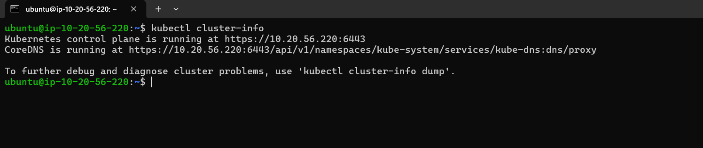
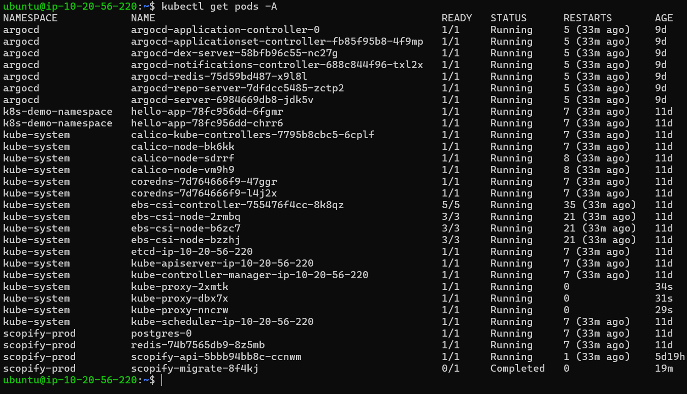
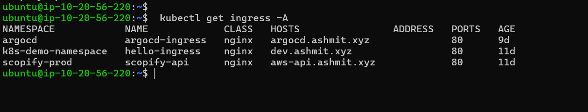

# Kubernetes

kubeadm cluster on private EC2 nodes, managed by Ansible bootstrap and Argo CD for application desired state.

---

## Cluster Architecture

| Role | EC2 key | Notes |
|------|---------|-------|
| Control plane | `master` | Single master (lab SPOF) |
| Workers | `worker-1`, `worker-2` | Schedulable data plane |
| Version | Kubernetes **1.35.6** | Pinned in `ansible/group_vars/all.yml` |
| Pod CIDR | `10.244.0.0/16` | kubeadm init |
| CNI | Calico **v3.29.4** | Avoids CEL `isCIDR` CRD break on older paths |
| Runtime | containerd + SystemdCgroup | Ansible `common` role |
| Ingress | ingress-nginx **controller-v1.15.1** baremetal | NodePort |
| Storage | aws-ebs-csi-driver + SC `gp3` | Helm on master |

```
kubectl / Argo CD
      │
      ▼
kube-apiserver :6443 (master)
      │
      ├── etcd / scheduler / controller-manager
      └── kubelet+containerd on workers
                │
                └── Calico fabric 10.244.0.0/16
```



This screenshot is `kubectl cluster-info` rather than `kubectl get nodes -o wide`, but it still confirms a live control plane endpoint and CoreDNS availability on the cluster.

---

## Control Plane

Installed by `ansible/roles/master`: kubeadm init, admin kubeconfig for `ubuntu`, Calico apply, Ingress-Nginx apply, Helm EBS CSI, join command for workers.

**HA:** Not configured. Losing master loses API (etcd on master).

---

## Worker Nodes

Join via `kubeadm join` from master hostvars; idempotent if kubelet.conf exists.

---

## Namespaces

| Namespace | Purpose |
|-----------|---------|
| `scopify-prod` | Production API stack |
| `scopify-dev` | Dev API stack |
| `ingress-nginx` | Ingress controller |
| `argocd` | Argo CD |
| `kube-system` | CNI, CSI, CoreDNS |
| `monitoring` | Planned |

---

## Deployments / Workloads

| Workload | Kind | Env |
|----------|------|-----|
| `scopify-api` | Deployment | replicas: 1 |
| `redis` | Deployment + PVC | AOF enabled |
| `postgres` | StatefulSet + PVC | Postgres 15 |
| `scopify-migrate` | Job (Argo PreSync) | `prisma migrate deploy` |



---

## Services

ClusterIP services for `scopify-api`, `postgres`, `redis` (see `*-service.yml`).

[ Screenshot Required ]

**Description:** `kubectl get svc -n scopify-prod`  
**TODO:** Waiting for screenshot

---

## Ingress

| Env | Host | Class |
|-----|------|-------|
| prod | `aws-api.ashmit.xyz` | `nginx` |
| dev | `dev-aws-api.ashmit.xyz` | `nginx` |
| argocd | `argocd.ashmit.xyz` | `nginx` + backend-protocol HTTPS |

Edge Nginx forwards to NodePort `32522`.



---

## Storage

- StorageClass `gp3`: provisioner `ebs.csi.aws.com`, encrypted, `WaitForFirstConsumer`, `allowVolumeExpansion: true`, reclaim `Delete`
- Postgres PVC 10Gi; Redis PVC 2Gi (prod manifests)

IAM: Terraform attaches `AmazonEBSCSIDriverPolicy` when `enable_ebs_csi = true`.

---

## Secrets

| Secret | Used by | In Git? |
|--------|---------|---------|
| `scopify-postgres` | Postgres | gitignored real file; `.example` committed |
| `scopify-api-env` | API + migrate | gitignored |
| `ghcr-secret` | imagePullSecrets | Created out-of-band |

Jenkins does **not** apply secrets.

---

## ConfigMaps

Platform: ingress-nginx forwarded-headers patch ConfigMap data in `k8s/platform/ingress-nginx/configmap-forwarded-headers.yml`.

---

## Scheduling

Default scheduler; no custom affinity/taints documented in app manifests. Master may schedule platform pods unless tainted (lab default: often schedulable).

---

## Networking

- Pod: Calico  
- Service: kube-proxy  
- North-south: Ingress-Nginx NodePort ← edge Nginx  
- East-west: ClusterIP  

NetworkPolicies: **TODO** — not present in reviewed app manifests.

---

## Ingress Controller

Baremetal manifest from upstream; NodePort service. Forwarded headers enabled so apps see real client IP behind edge proxy.

---

## Resource Requests / Limits

From prod API / data manifests:

| Container | Requests | Limits |
|-----------|----------|--------|
| API | 100m CPU, 256Mi | memory 512Mi |
| Postgres | 100m, 256Mi | memory 512Mi |
| Redis | 50m, 128Mi | memory 256Mi |
| Migrate Job | 100m, 256Mi | memory 512Mi |

No CPU limits on API (memory-only limit) — avoids CFS throttle surprises in lab.

---

## Scaling

- Horizontal: increase `replicas` (no HPA YAML in repo)  
- Cluster: add Terraform workers + join  

---

## Rolling Updates

Deployment default RollingUpdate; migrate PreSync runs before new pods take desired state during Argo sync.

---

## Self Healing

- kubelet restarts containers per restartPolicy  
- Deployment recreates pods  
- Argo `selfHeal` when enabled on Application  
- Probes: API `/health`; Postgres `pg_isready`; Redis `PING`

---

## Kustomize Layout

```
k8s/scopify-backend/{dev,prod}/
  kustomization.yaml  → namespace, postgres, redis, migrate, api, ingress
  secrets/            → not listed in kustomization
```

---

## Related

- [Argo CD](../argocd/README.md)  
- [ADR-001 kubeadm vs EKS](../decisions/ADR-001-kubeadm-vs-eks.md)  
- [ADR-010 Calico](../decisions/ADR-010-calico.md)
