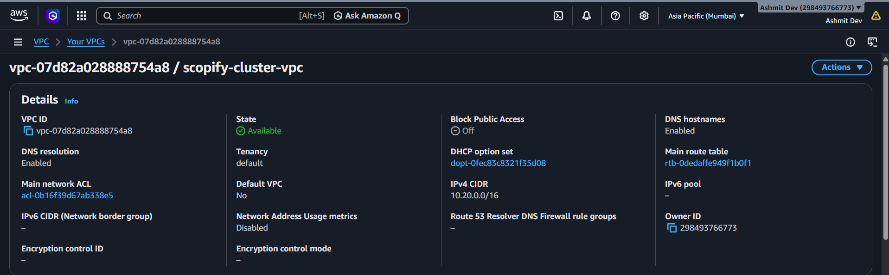
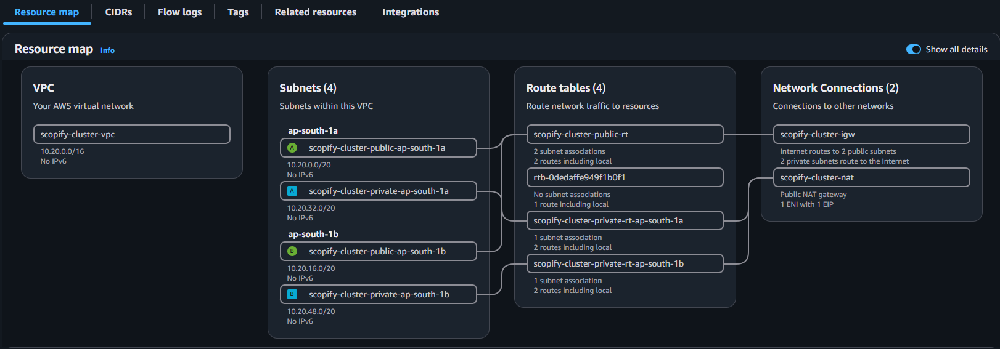
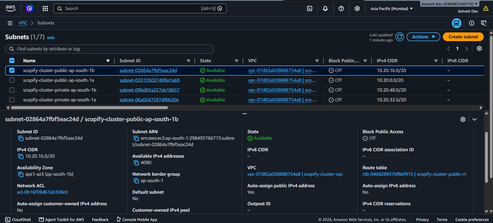
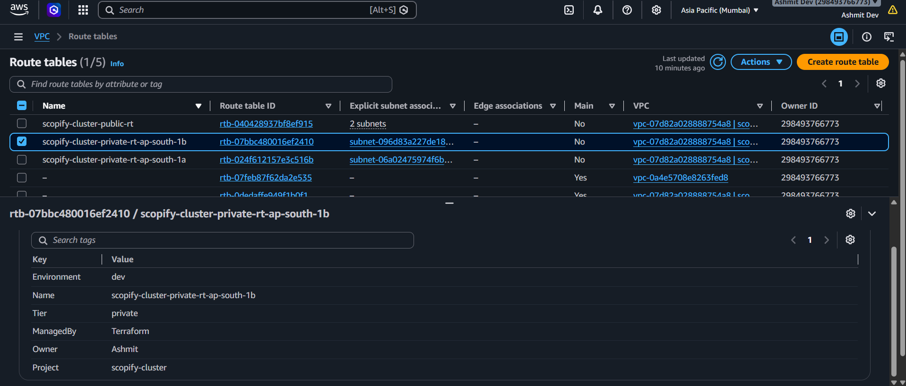
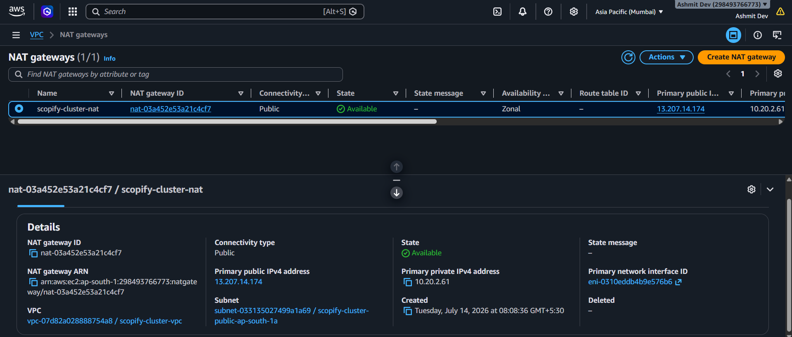
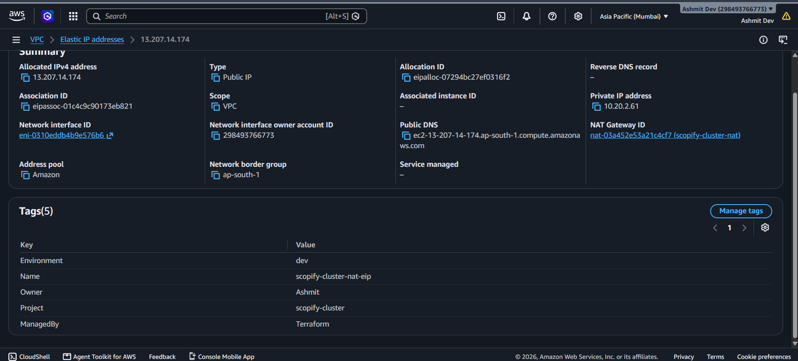
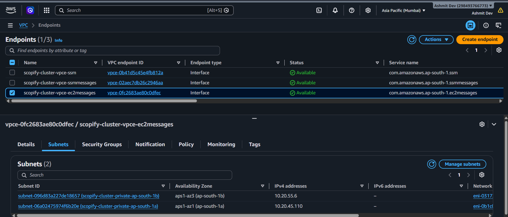
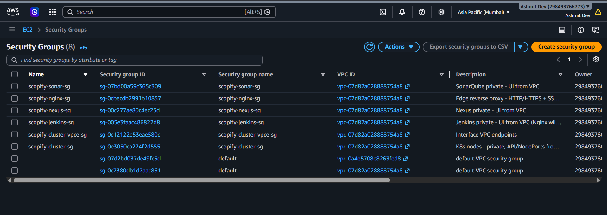
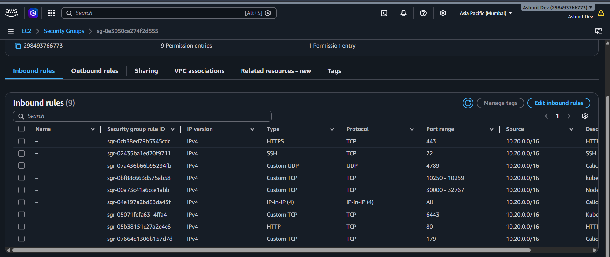
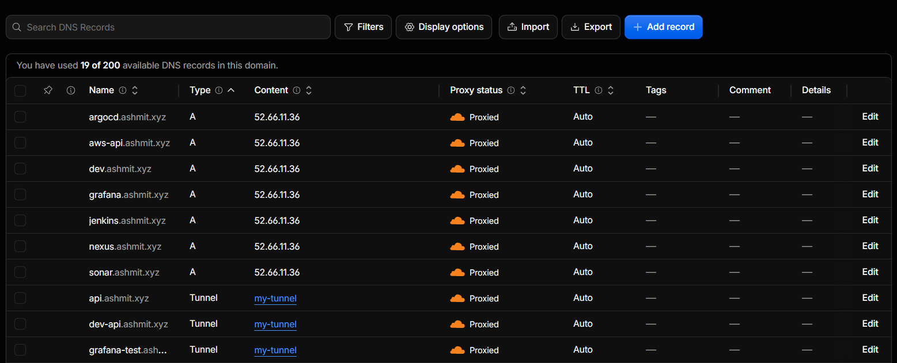

# Networking

Enterprise networking documentation for the Scopify AWS VPC. Values below are taken from `terraform.tfvars`, `modules/vpc`, and Ansible edge config. Live console IDs/IPs are left as TODO where not committed.

---

## VPC

**Why it exists:** Default VPC labs leave every instance publicly addressable. A custom VPC enables a real public/private split and controlled routing.

| Attribute | Value |
|-----------|-------|
| Mode | `use_custom_vpc = true` |
| CIDR | `10.20.0.0/16` |
| DNS support / hostnames | Enabled in module |
| Name tag pattern | `${project_name}-vpc` → `scopify-cluster-vpc` |
| Region | `ap-south-1` |

**Security:** Boundary for all SG CIDR references.  
**Cost:** VPC itself free; NAT/endpoints/EIPs bill.  
**Alternatives:** Default VPC (rejected for frozen architecture); shared Hub-Spoke (overkill for lab).



The imported VPC screenshot confirms the live VPC name `scopify-cluster-vpc` and CIDR `10.20.0.0/16`.

---

## CIDRs

| Block | Purpose |
|-------|---------|
| `10.20.0.0/16` | VPC |
| Public `/20`s | Index 0..az_count-1 via `cidrsubnet(..., 4, i)` |
| Private `/20`s | Index az_count.. via `cidrsubnet(..., 4, i + az_count)` |
| `10.244.0.0/16` | Pod network (kubeadm `--pod-network-cidr`) — **not** VPC routed |

**Why /16 VPC + /20 subnets:** Room for growth without redesign; 2 AZ × public/private fits cleanly.

---

## Subnets

Created by `modules/vpc` with tags `Tier = public|private`.

**Live subnet IDs:**

TODO: Waiting for screenshot / `terraform output public_subnet_ids` / `private_subnet_ids`

---

## Public Subnets

**Why:** Host Internet-facing Nginx and NAT Gateway (NAT must sit on a public subnet with IGW route).

| Property | Value |
|----------|-------|
| `map_public_ip_on_launch` | `true` (module input from root) |
| Count | `vpc_az_count` (2) |
| Workloads | `nginx` instance; NAT GW on public[0] |

**Security implication:** Only place where `associate_public_ip = true` is intended for Nginx.  
**Cost:** No subnet fee; EIP/NAT cost elsewhere.



The resource map shows the public subnets `10.20.0.0/20` and `10.20.16.0/20`, including their association with the public route table and upstream Internet connectivity.

---

## Private Subnets

**Why:** Jenkins, Sonar, Nexus, Master, workers must not be reachable from Internet.

| Property | Value |
|----------|-------|
| Public IP | `false` |
| Default route | NAT Gateway |
| Workloads | All non-nginx instances |

**Security:** Inbound only via SGs from VPC (or SSM channel).  
**Alternatives considered:** Public subnet + restrictive SG only — cheaper (no NAT) but weaker posture; rejected for frozen target.



---

## Route Tables

| Table | Destination | Target |
|-------|-------------|--------|
| Public | `0.0.0.0/0` | IGW |
| Private (per AZ) | `0.0.0.0/0` | NAT Gateway |

**Why explicit depends_on in module:** Private associations wait for NAT route so EC2 user-data/SSM is not racing an incomplete network (`DEPENDENCY_FLOW.md`).



---

## Internet Gateway

**Why:** Public subnet Internet ingress/egress for Nginx and for NAT’s upstream.

Attached to custom VPC; Nginx EIP depends on VPC/IGW readiness.

---

## NAT Gateway

**Why:** Private instances need apt, container image pulls (GHCR/Docker Hub), Helm charts, SSM agent updates without public IPs.

| Setting | Value |
|---------|-------|
| `enable_nat_gateway` | `true` |
| Placement | `aws_subnet.public[0]` |
| HA | **Single NAT** (cost choice) |

**Cost implication:** On the order of tens of USD/month + data processing — dominant network cost for this lab.  
**Alternatives:** NAT Instance (cheaper, more ops); no NAT + VPC endpoints only (SSM works, general Internet pulls fail); public IPs (rejected).



---

## Elastic IP

| EIP | Attached to | Why |
|-----|-------------|-----|
| Nginx EIP | `aws_eip.nginx` → nginx instance | Stable DNS target for all `*.ashmit.xyz` |
| NAT EIP | NAT Gateway | Stable egress source for private tier |

**Cost:** Associated EIPs typically not charged as idle; unattached EIPs are.  
**Rule:** Humans DNS-point only at Nginx EIP.

TODO: Waiting for live `nginx_eip` / `nat_eip` values from `terraform output` (do not invent).



---

## VPC Endpoints

| Endpoint | Enabled in tfvars | Why |
|----------|-------------------|-----|
| Interface `ssm`, `ssmmessages`, `ec2messages` | `enable_ssm_vpc_endpoints = true` | Reliable private SSM |
| Gateway S3 | Module supports; `enable_vpc_endpoints=false` but SSM flag creates endpoints module — gateway enablement gated by `enable_vpc_endpoints && vpc_endpoint_gateway_enabled` in locals | See `locals.tf` |
| Interface ECR/logs/ec2 | Off | Cost control |

**Security:** Keeps SSM control traffic on AWS private network.  
**Cost:** Interface endpoints hourly per AZ/subnet attachment.  
**Alternative:** NAT-only SSM (works; still used as backup path).



---

## Security Groups

Defined in `terraform.tfvars`:

| Key | Attached to | Inbound summary |
|-----|-------------|-----------------|
| `nginx` | Nginx | 22/80/443 `0.0.0.0/0` |
| `cluster` | master, workers | 22, 80, 443, 6443, 30000–32767, 10250–10259, Calico 179/TCP, proto 4, 4789/UDP from `10.20.0.0/16` |
| `jenkins` | Jenkins | 22, 8080, 50000 from VPC |
| `sonar` | Sonar | 22, 9000 from VPC |
| `nexus` | Nexus | 22, 8081 from VPC |

**Why Calico rules:** Default Calico uses BGP + IPIP; VXLAN-only SG breaks pod networking (documented in tfvars comments).

**Future:** Replace VPC CIDR sources with Nginx SG ID for tool UI ports.





---

## Network ACLs

**As-built:** No custom NACL resources in Terraform modules reviewed — **AWS default NACLs** (allow all) apply.

**Why not customized yet:** SGs provide stateful filtering sufficient for lab; NACLs add complexity and break connectivity when misordered.

TODO: Waiting for project details if custom NACLs were applied out-of-band.

---

## DNS

| Provider | Role |
|----------|------|
| Cloudflare | Zone `ashmit.xyz` A records → Nginx EIP (as-built per Ansible/docs) |
| Squarespace | Mentioned historically in ARCHITECTURE; migration to Cloudflare preferred |

Hostnames (Ansible `group_vars/all.yml` + Ingress):

| Hostname | Upstream class |
|----------|----------------|
| `jenkins.ashmit.xyz` | Jenkins EC2 |
| `sonar.ashmit.xyz` | Sonar EC2 |
| `nexus.ashmit.xyz` | Nexus EC2 |
| `dev.ashmit.xyz` | K8s Ingress NodePort |
| `aws-api.ashmit.xyz` | K8s Ingress → prod API |
| `argocd.ashmit.xyz` | K8s Ingress → Argo CD |
| `dev-aws-api.ashmit.xyz` | Ingress rule in `scopify-dev` |



---

## Cloudflare

**Why:** DNS + path to WAF/CDN (orange cloud) without AWS Route 53 cost; DNS-01 API for wildcard certificates.

Certbot uses Cloudflare DNS plugin; token in gitignored `nginx_secrets.yml`.

**Security:** Token scope should be Zone:DNS:Edit only.  
**Tradeoff:** Webhooks from Sonar to public `jenkins.ashmit.xyz` may be blocked by Cloudflare — Jenkinsfile documents private IP webhook preference.

---

## NGINX Reverse Proxy

- Image: `nginx:1.27-alpine`
- Container name: `scopify-nginx`
- Config template: `ansible/roles/nginx/templates/default.conf.j2`
- TLS: wildcard `ashmit.xyz` + `*.ashmit.xyz`, protocols TLSv1.2/1.3
- K8s upstream NodePort: `32522`

**Why Nginx on EC2 instead of only Ingress:** Terminates public TLS once; proxies both non-K8s tools and Ingress; learning surface for edge patterns before ALB.

[ Screenshot Required ]

**Description:** `curl -I https://jenkins.ashmit.xyz` + host nginx config snippet  
**TODO:** Waiting for screenshot

---

## Traffic Flow

See [architecture/traffic-flow.md](../architecture/traffic-flow.md).

```
Internet → Cloudflare → EIP → IGW → Public subnet → Nginx
  ├─→ Private IP:8080/9000/8081 (tools)
  └─→ Workers:32522 → Ingress → Service → Pod
```
