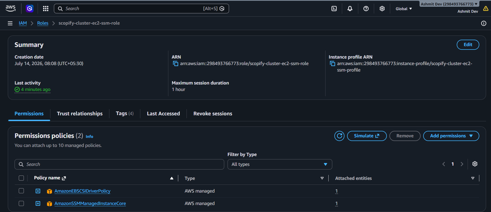
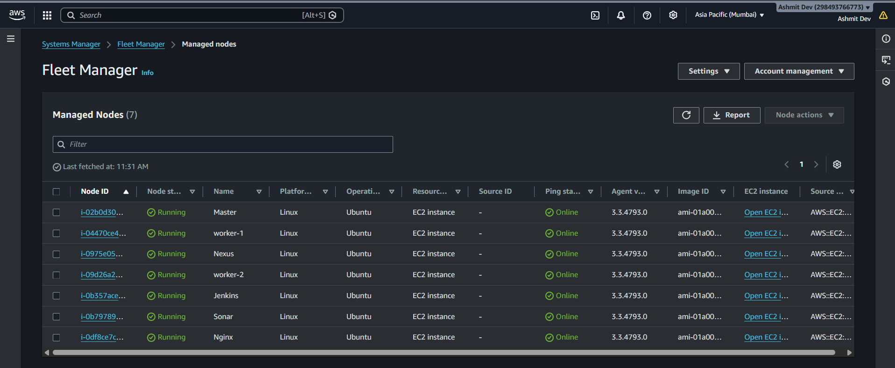

# Security

Security architecture and residual lab risks for Scopify infrastructure.

---

## IAM

| Construct | Purpose |
|-----------|---------|
| `scopify-cluster-ec2-ssm-role` (pattern) | EC2 trust → SSM |
| Policy `AmazonSSMManagedInstanceCore` | Session Manager |
| Optional `AmazonEBSCSIDriverPolicy` | EBS CSI volume attach |
| Instance profile on all nodes when `enable_ssm` | Uniform admin path |

Operator AWS credentials for Terraform are **outside** this repo’s modules.

---

## Least Privilege

**Achieved:**

- Tool UI ports not world-open (VPC CIDR only)  
- Private instances without public IPs  
- App secrets not committed  

**Not yet least-privilege:**

- Nginx SSH `0.0.0.0/0`  
- Cluster/tool rules use entire VPC CIDR instead of peer SG IDs  
- Shared instance profile may be broader than per-role roles  

---

## SSM

Primary admin access. Cloud-init installs `amazon-ssm-agent` via snap when `install_ssm_agent = true`.

```bash
aws ssm start-session --target <instance-id> --region ap-south-1
```

Hints emitted by Terraform output `ssm_connect_hint`.

---

## No Bastion

Bastion explicitly rejected (`AWS_GAPS.md`). SSM replaces jump hosts; Nginx can still ProxyJump for Ansible SSH if needed.

**Why:** Fewer public SSH endpoints, no bastion patching, IAM-auditable sessions.

---

## Private Networking

Custom VPC private subnets + NAT + SG segmentation. Kubernetes API `6443` not exposed to Internet in tfvars.

---

## VPC Endpoints

SSM interface endpoints enabled for private Session Manager control plane traffic. Extra ECR/logs endpoints off for cost.

---

## TLS

| Layer | Mechanism |
|-------|-----------|
| Edge | Let’s Encrypt wildcard via Certbot DNS-01 (Cloudflare) |
| Protocols | TLSv1.2 / TLSv1.3 on Nginx |
| In-cluster Argo | Ingress annotation `backend-protocol: HTTPS` to argocd-server:443 |
| App Ingress | HTTP to Ingress from edge (TLS already terminated) |

---

## Secrets

| Secret | Storage |
|--------|---------|
| K8s `scopify-api-env`, `scopify-postgres` | gitignored YAML; kubectl apply once |
| `nginx_secrets.yml` Cloudflare token | gitignored Ansible vars |
| Jenkins `github-token` | Jenkins credentials store |
| GHCR pull | `ghcr-secret` in cluster |

**Gap:** No SealedSecrets / ExternalSecrets / KMS CMK for Secrets Manager.

---

## Image Scanning

Trivy FS + image in Jenkins; **non-blocking**.  

Future: fail `main` on CRITICAL.

---

## Container Security

- Non-root image user: **TODO** verify Dockerfile USER  
- Resource limits on memory  
- imagePullSecrets for private GHCR  
- Readiness/liveness on API  

No PodSecurity admission / PSS configs found in reviewed manifests.

---

## Node Security

- Ubuntu AMI pinned by ID in tfvars  
- Swap disabled (kubeadm)  
- SSM instead of open SSH on private nodes (SSH still allowed from VPC CIDR)  
- Root EBS encryption enabled in EC2 module path  

---

## Network Isolation

| Boundary | Control |
|----------|---------|
| Internet → private | No public IP + SG |
| Internet → edge | Nginx SG only |
| Edge → tools | Proxy to private IPs |
| Pod → pod | Calico; NetworkPolicy TODO |
| AWS APIs | NAT and/or VPC endpoints |

---

## Future Hardening

1. Restrict Nginx SSH to admin IP or disable SSH  
2. SG source = Nginx SG for 8080/9000/8081  
3. Enable blocking Trivy + Sonar QG on `main`  
4. ExternalSecrets + AWS Secrets Manager  
5. Pod Security Standards / NetworkPolicies  
6. GuardDuty / Security Hub (account level)  
7. EBS default encryption CMK  
8. Remove world-open anything; WAF via Cloudflare rules  
9. Rotate GitHub PAT used by Jenkins; prefer GitHub App  





This imported screenshot confirms an active `aws ssm start-session` path into a private instance. A dedicated Fleet Manager screenshot is still worth adding later if you want explicit console evidence of `Online` status.
