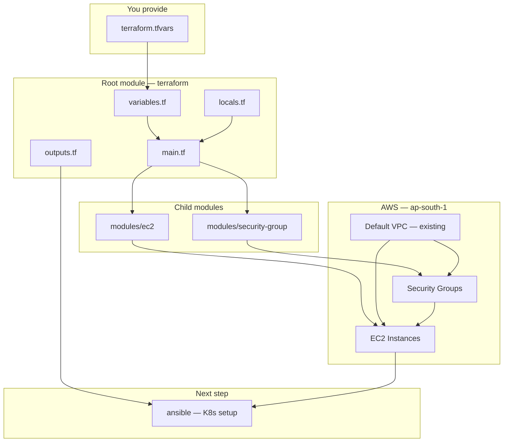
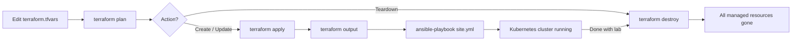

# Terraform flow — `terraform`

End-to-end guide: how configuration becomes AWS resources, how to create, change, and destroy, with examples.

---

## What this stack builds

| Resource | Count | Module |
|----------|-------|--------|
| EC2 instances (Master + workers) | 3 (default) | `modules/ec2` |
| Security groups | 1+ (default: `cluster`) | `modules/security-group` |
| Default VPC / subnets | data sources only (not created) | — |

After Terraform, Ansible (`ansible/`) configures Kubernetes on the nodes using EC2 tags for dynamic inventory.

---

## Architecture flow



---

## File roles

```
terraform/
├── terraform.tfvars          ← YOUR values (region, nodes, ports, SGs)
├── variables.tf              ← declares what tfvars can set
├── locals.tf                 ← computed values (subnet spread, SG ID mapping)
├── main.tf                   ← wires modules together
├── outputs.tf                ← IPs, SSH commands, cluster_summary
├── providers.tf              ← AWS provider + default tags
├── modules/
│   ├── security-group/       ← one SG per map key, dynamic ingress rules
│   └── ec2/                  ← one instance per map key
├── flow.md                   ← this document
└── cmds.md                   ← quick command reference (create / destroy)
```

---

## Create flow (step by step)

### Step 1 — Define values in `terraform.tfvars`

Everything starts here. Root `main.tf` does not hard-code ports or instance names.

```hcl
aws_region   = "ap-south-1"
project_name = "scopify-cluster"
key_pair_name = "terraform-key"

security_groups = {
  cluster = {
    name = "scopify-cluster-sg"
    ingress_rules = [
      { description = "SSH", from_port = 22, to_port = 22, protocol = "tcp", cidr_blocks = ["0.0.0.0/0"] },
      { description = "Kubernetes API", from_port = 6443, to_port = 6443, protocol = "tcp", cidr_blocks = ["0.0.0.0/0"] },
    ]
  }
}

instances = {
  master   = { name = "Master",   security_group_keys = ["cluster"] }
  worker-1 = { name = "worker-1", security_group_keys = ["cluster"] }
  worker-2 = { name = "worker-2", security_group_keys = ["cluster"] }
}
```

### Step 2 — Terraform reads variables

`variables.tf` validates types. Each key in `security_groups` becomes one SG module call; each key in `instances` becomes one EC2 module call.

### Step 3 — `main.tf` calls modules

```hcl
# Pseudocode — what actually happens

module "security_groups" {
  for_each = var.security_groups          # cluster → module instance
  source   = "./modules/security-group"
  ingress_rules = each.value.ingress_rules
}

module "nodes" {
  for_each = var.instances                # master, worker-1, worker-2
  source   = "./modules/ec2"
  security_group_ids = [ module.security_groups["cluster"].id, ... ]
}
```

`locals.tf` resolves `security_group_keys` on each instance into real SG IDs:

```hcl
# worker-1 has security_group_keys = ["cluster"]
# → security_group_ids = [ module.security_groups["cluster"].security_group_id ]
```

### Step 4 — Modules create AWS resources

**`modules/security-group`** — dynamic ingress blocks from your rule list:

```hcl
dynamic "ingress" {
  for_each = var.ingress_rules
  content {
    from_port   = ingress.value.from_port
    to_port     = ingress.value.to_port
    protocol    = ingress.value.protocol
    cidr_blocks = ingress.value.cidr_blocks
  }
}
```

**`modules/ec2`** — one `aws_instance` with attached SGs, EBS volume, IMDSv2, tags (`Role`, `Ansible=true`).

### Step 5 — Apply

```bash
cd terraform
terraform init
terraform plan      # preview changes
terraform apply     # create / update resources
```

### Step 6 — Read outputs → Ansible

```bash
terraform output cluster_summary
terraform output nodes
```

Ansible dynamic inventory (`ansible/inventories/aws_ec2.yml`) finds instances by tags:

- `tag:Ansible=true`
- `tag:Project=scopify-cluster`
- `tag:Role=master|worker-1|worker-2`

Then run K8s setup:

```bash
cd ansible
ansible-playbook site.yml
```

---

## Example scenarios

### Example A — Default cluster (current setup)

One SG with all K8s ports, three nodes all using it.

```hcl
security_groups = {
  cluster = {
    name = "scopify-cluster-sg"
    ingress_rules = [ /* SSH, 80, 443, 6443, 30000-32767, ... */ ]
  }
}

instances = {
  master   = { name = "Master",   security_group_keys = ["cluster"] }
  worker-1 = { name = "worker-1", security_group_keys = ["cluster"] }
  worker-2 = { name = "worker-2", security_group_keys = ["cluster"] }
}
```

**Result:** 1 SG + 3 EC2 instances in default VPC public subnets.

---

### Example B — Two SGs, different ports

Admin SG opens SSH only from your IP. Cluster SG opens K8s ports.

```hcl
security_groups = {
  cluster = {
    ingress_rules = [
      { from_port = 6443, to_port = 6443, protocol = "tcp", cidr_blocks = ["0.0.0.0/0"] },
      { from_port = 30000, to_port = 32767, protocol = "tcp", cidr_blocks = ["0.0.0.0/0"] },
    ]
  }
  admin = {
    ingress_rules = [
      { description = "SSH from office", from_port = 22, to_port = 22, protocol = "tcp", cidr_blocks = ["203.0.113.10/32"] },
    ]
  }
}

instances = {
  master = {
    name                = "Master"
    security_group_keys = ["cluster", "admin"]   # union of both rule sets
  }
  worker-1 = {
    name                = "worker-1"
    security_group_keys = ["cluster"]             # no admin SG — workers skip SSH from internet
  }
}
```

**Result:** Master gets K8s ports + SSH from your IP. Workers get K8s ports only.

---

### Example C — Add a fourth worker

Add one entry to `instances` and apply:

```hcl
instances = {
  master   = { name = "Master",   security_group_keys = ["cluster"] }
  worker-1 = { name = "worker-1", security_group_keys = ["cluster"] }
  worker-2 = { name = "worker-2", security_group_keys = ["cluster"] }
  worker-3 = { name = "worker-3", security_group_keys = ["cluster"] }  # NEW
}
```

```bash
terraform plan    # shows: + module.nodes["worker-3"]
terraform apply
```

Then join the new node with Ansible:

```bash
ansible-playbook site.yml --limit workers
```

---

### Example D — Scale down (remove one worker)

Remove the key from `instances` and apply — Terraform destroys only that instance:

```hcl
instances = {
  master   = { name = "Master",   security_group_keys = ["cluster"] }
  worker-1 = { name = "worker-1", security_group_keys = ["cluster"] }
  # worker-2 removed
}
```

```bash
terraform plan    # shows: - module.nodes["worker-2"]
terraform apply
```

This is the **preferred** way to remove a single resource (cleaner than `-target` destroy).

---

## Destroy flow

Destroy removes resources Terraform manages. It does **not** delete the default VPC, your AWS account, or an EC2 key pair created outside this stack.

### What gets destroyed (full destroy)

| Resource | Destroyed? |
|----------|------------|
| EC2 instances (Master, workers) | Yes |
| EBS root volumes (delete_on_termination=true) | Yes |
| Security groups created by modules | Yes |
| Default VPC / subnets | No (data sources only) |
| EC2 key pair (`terraform-key`) | No (referenced by name, not managed here) |

### Destroy order (automatic)

Terraform destroys in dependency order:

1. **EC2 instances** first (they reference security groups)
2. **Security groups** after no instances attach them

You do not need to destroy manually in reverse order.

---

### Option 1 — Destroy everything (recommended for teardown)

```bash
cd terraform

terraform plan -destroy    # preview what will be removed
terraform destroy          # prompts for confirmation
```

Auto-approve (CI/scripts only):

```bash
terraform destroy -auto-approve
```

**Example output summary:**

```
Plan: 0 to add, 0 to change, 4 to destroy.
  - module.nodes["master"].aws_instance.this
  - module.nodes["worker-1"].aws_instance.this
  - module.nodes["worker-2"].aws_instance.this
  - module.security_groups["cluster"].aws_security_group.this
```

---

### Option 2 — Destroy via Docker (same as create)

From repo root with AWS creds mounted:

```bash
docker run --rm -it \
  -v "$(pwd):/workspace" \
  -v "$HOME/.aws:/root/.aws:ro" \
  -w /workspace/terraform \
  custom-ansible:latest \
  sh -c "terraform init && terraform destroy"
```

---

### Option 3 — Destroy a single instance (targeted)

Use when you want to remove one node without editing tfvars first:

```bash
terraform destroy -target='module.nodes["worker-2"]'
```

Then remove `worker-2` from `terraform.tfvars` and run `terraform apply` so state matches config.

---

### Option 4 — Remove from config and apply (preferred for partial teardown)

1. Delete the instance key from `instances` in `terraform.tfvars`
2. Run `terraform apply`
3. Terraform destroys only the removed resource

Same pattern works for security groups — remove a SG key **only after** no instance references it in `security_group_keys`.

---

### Option 5 — Destroy only security group (advanced)

A SG cannot be deleted while an EC2 instance is attached:

```bash
# This FAILS if instances still use the SG:
terraform destroy -target='module.security_groups["cluster"]'

# Correct order: destroy instances first, then SG
terraform destroy -target='module.nodes'
terraform destroy -target='module.security_groups["cluster"]'
```

For full teardown, use `terraform destroy` instead.

---

## Full lifecycle diagram



---

## Common commands cheat sheet

| Goal | Command |
|------|---------|
| First-time setup | `terraform init` |
| Preview create/update | `terraform plan` |
| Create / update | `terraform apply` |
| Preview destroy | `terraform plan -destroy` |
| Destroy all | `terraform destroy` |
| Show IPs | `terraform output cluster_summary` |
| Destroy one node | Remove from tfvars + `apply`, or `destroy -target='module.nodes["worker-2"]'` |
| Add one node | Add to tfvars + `apply` |

See **`cmds.md`** for Docker/WSL one-liners.

---

## Troubleshooting

| Problem | Cause | Fix |
|---------|-------|-----|
| SG destroy fails | EC2 still attached | Destroy instances first or use full `terraform destroy` |
| Plan wants to recreate SG | SG `name` changed in tfvars | Set `name = "scopify-cluster-sg"` to match existing |
| Ansible finds no hosts | Instances destroyed or tags wrong | `terraform output nodes`; check `Ansible=true` tag |
| State out of sync | Manual deletion in AWS console | `terraform refresh` or import/remove from state |

---

## Related docs

| File | Contents |
|------|----------|
| `cmds.md` | Copy-paste commands for init / apply / destroy |
| `modules.md` | Module layout and port-customization patterns |
| `terraform.tfvars.example` | Annotated variable examples |
| `ansible/cmds.md` | Ansible + Docker workflow after Terraform |
